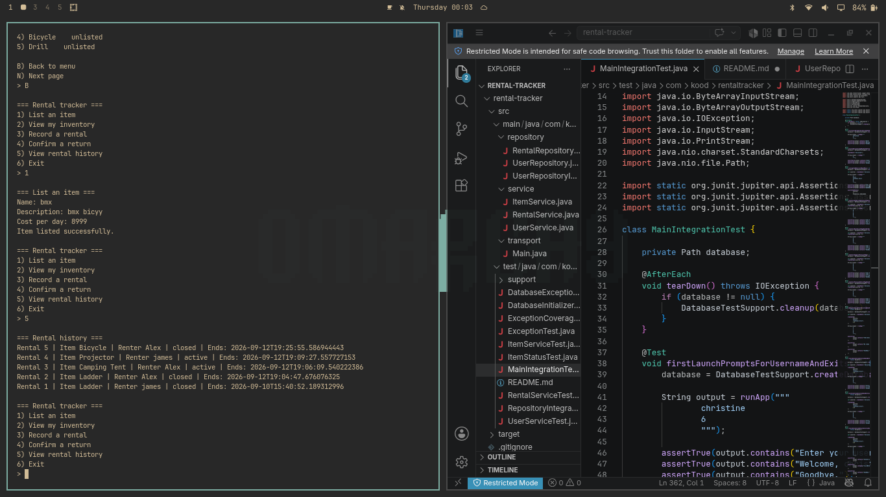
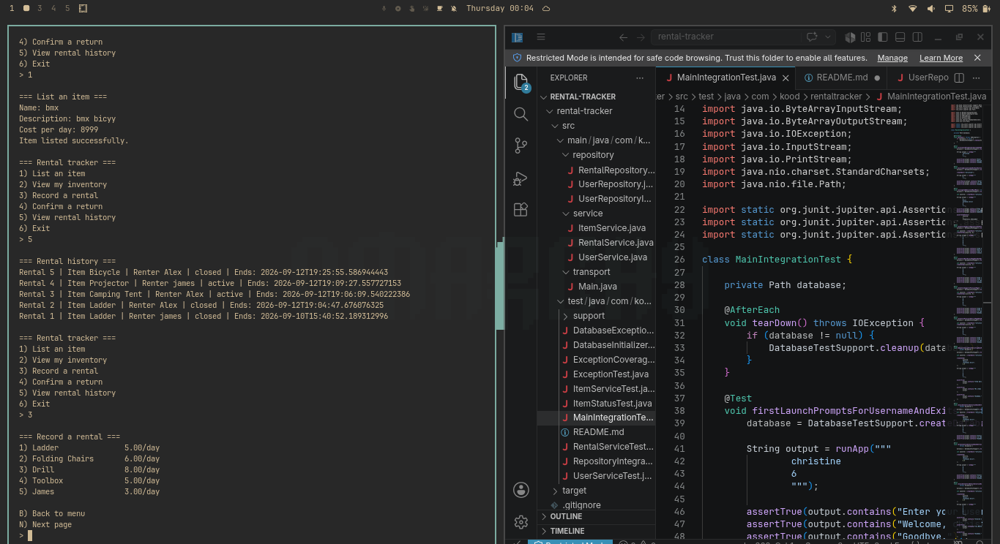
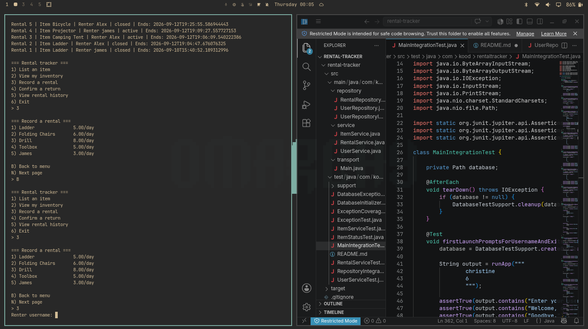
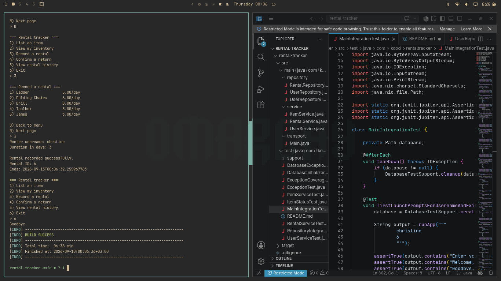
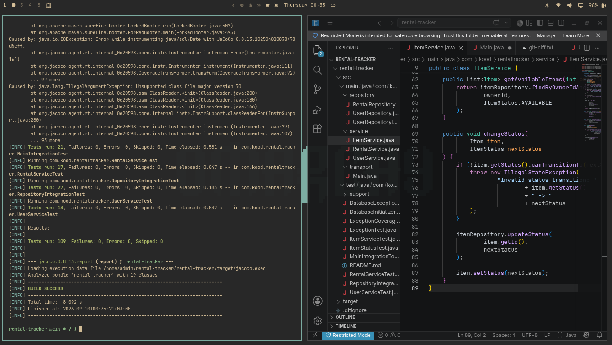
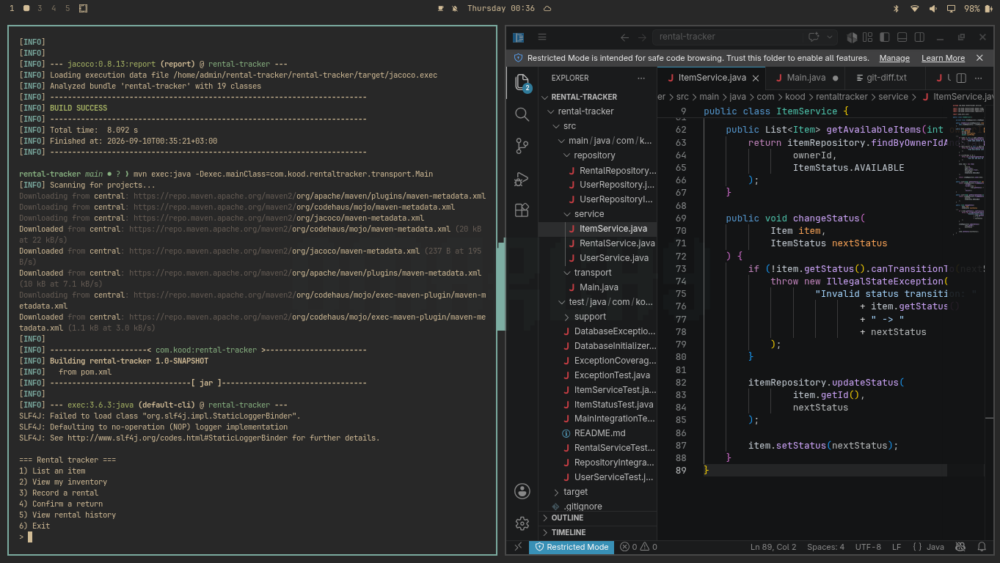
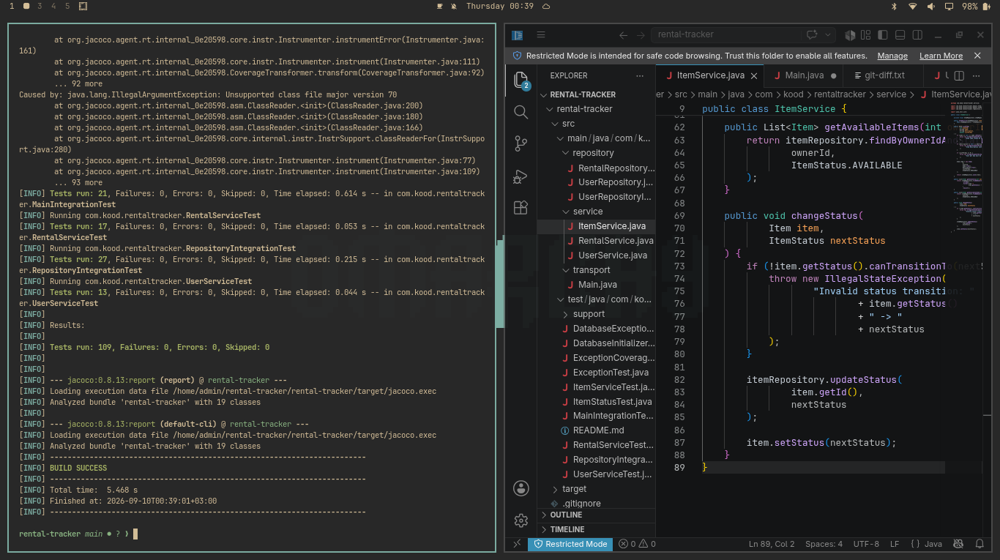

# Rental Tracker

A command-line rental management application for tracking personal items, renters, and active rentals. The application uses a persistent SQLite database to maintain rental information between sessions while enforcing business rules around item availability, listing status, rentals, and returns.

## Team

* **Christine Nyambura** — Lead
* **Francis Titus**

## Overview

Rental Tracker is a single-user rental management application designed for people who rent out personal items.

The application allows users to:

* Create and manage a local account
* List items available for rental
* View and manage their inventory
* Browse inventory using pagination
* Delist and relist items
* Rent available items to renters
* Record rental duration and calculate return times
* Confirm returned items
* Persist all data in a SQLite database

The application also enforces the rules governing item and rental state. For example, an item that is already rented cannot be rented again, and an unlisted item cannot be rented until it is listed again.

Rental Tracker is the first version of a larger rental-management concept. A later version extends the system into a multi-user marketplace with additional error handling, logging, and Docker packaging.

---

## Features

### User Accounts

* Creates a local user account on first launch
* Loads the existing account on subsequent runs
* Persists user information in the database

### Item Management

* Add items with:

  * Item name
  * Description
  * Cost per day
* View personal inventory
* Browse items using pagination
* Open an individual item's detail view
* Delist an available item
* Relist a previously delisted item

### Rental Management

* Rent an available item to a renter
* Create a new renter or reuse an existing renter
* Specify the rental duration
* Automatically calculate the rental end time
* Prevent an already-rented item from being rented again
* Prevent unlisted items from being rented
* Confirm returned items
* Close completed rental records

### Persistent Storage

All application data is stored in SQLite, allowing users, items, renters, and rental records to remain available between application runs.

---

## Screenshots

### Application Launch



### User and Inventory Flow



### Item Management



### Item Details



### Rental Flow



### Rental Confirmation



### Return and Final State



---

## Architecture

The application follows a layered architecture where each layer has a clearly defined responsibility.

| Layer              | Responsibility                                                                            |
| ------------------ | ----------------------------------------------------------------------------------------- |
| **Transport**      | CLI menus, prompts, input handling, and user-facing views                                 |
| **Service**        | Business rules, validation, state transitions, rental calculations, and renter management |
| **Repository**     | Database access, CRUD operations, queries, and persistence                                |
| **Domain**         | Core application objects such as `User`, `Item`, and `Rental`                             |
| **Infrastructure** | Database connection and SQLite setup                                                      |

### Layered Flow

```text
User
  │
  ▼
Transport
  │
  ▼
Service
  │
  ▼
Repository
  │
  ▼
SQLite Database
```

Domain objects are shared between the relevant layers without allowing the transport or service layers to access the database directly.

This separation keeps database concerns isolated from business logic and makes the application easier to test and maintain.

---

## Item State Management

Item availability is represented using explicit states:

```text
available ───────► rented ───────► available
    │
    ▼
unlisted ────────► available
```

The application enforces valid state transitions in the service layer.

Examples:

* An **available** item can be rented.
* A **rented** item cannot be rented again.
* A **rented** item cannot be rented to another renter until it is returned.
* An **available** item can be delisted.
* An **unlisted** item cannot be rented.
* A returned item becomes available again.

The database also uses a `CHECK` constraint to prevent invalid status values from being persisted.

---

## Data Model

Rental Tracker uses three primary database tables.

### `users`

| Column       | Type      | Description                        |
| ------------ | --------- | ---------------------------------- |
| `id`         | INTEGER   | Primary key                        |
| `username`   | TEXT      | Unique username                    |
| `password`   | TEXT      | Reserved for future authentication |
| `created_at` | TIMESTAMP | Automatically set by the database  |

### `listed_items`

| Column         | Type      | Description                          |
| -------------- | --------- | ------------------------------------ |
| `item_id`      | INTEGER   | Primary key                          |
| `owner_id`     | INTEGER   | Foreign key referencing `users`      |
| `item_name`    | TEXT      | Name of the item                     |
| `description`  | TEXT      | Item description                     |
| `cost_per_day` | NUMERIC   | Daily rental cost                    |
| `status`       | TEXT      | `available`, `rented`, or `unlisted` |
| `created_at`   | TIMESTAMP | Automatically set by the database    |

### `rentals`

| Column        | Type      | Description                            |
| ------------- | --------- | -------------------------------------- |
| `rental_id`   | INTEGER   | Primary key                            |
| `item_id`     | INTEGER   | Foreign key referencing `listed_items` |
| `renter_id`   | INTEGER   | Foreign key referencing `users`        |
| `start_time`  | TIMESTAMP | Rental start time                      |
| `end_time`    | TIMESTAMP | Calculated rental end time             |
| `returned_at` | TIMESTAMP | Return timestamp; `NULL` while active  |
| `status`      | TEXT      | `active` or `closed`                   |

An Entity Relationship diagram showing the relationships between the tables is available at:

```text
docs/er-diagram.png
```

---

## Error Handling

Database errors are handled inside the repository layer and converted into application-specific exceptions.

This prevents database implementation details from leaking into the service and transport layers.

The application handles errors including:

* **Connection failure** — the database cannot be opened or accessed.
* **Constraint violation** — a `NOT NULL`, `UNIQUE`, `CHECK`, or foreign-key constraint is violated.
* **Not found** — a requested database record does not exist.
* **Mapping exception** — database data cannot be converted into the corresponding domain object.

This allows higher layers to respond appropriately instead of exposing raw SQLite exceptions to the user.

---

## Technologies

* **Java 17+**
* **Maven**
* **SQLite**
* **SQLite JDBC Driver**
* **JUnit 5**
* **JaCoCo**
* **Git / Gitea**

---

## Getting Started

### Prerequisites

Make sure the following are installed:

* Java JDK 17 or later
* Maven
* Git

Verify Java and Maven:

```bash
java -version
mvn -version
```

### Clone the Repository

```bash
git clone https://gitea.kood.tech/christinenyambura/rental-tracker.git
cd rental-tracker
```

### Build the Project

```bash
mvn clean install
```

### Run the Application

```bash
mvn exec:java -Dexec.mainClass=com.kood.rentaltracker.transport.Main
```

On the first launch, the application prompts for a username and creates the local account.

On subsequent launches, the existing account is loaded from the database.

---

## Database

Rental Tracker uses SQLite for persistent storage.

The database stores:

* User accounts
* Listed items
* Item status
* Rental records
* Rental start and end times
* Return information

The database schema is initialized automatically by the application.

---

## Testing

The project uses automated tests to verify both persistence and application behaviour.

Run the complete test suite with:

```bash
mvn test
```

### Test Strategy

Tests use a real temporary SQLite database rather than mocking the repository or database layer.

Each test establishes its own database state, performs an operation, and verifies the resulting state.

This allows the tests to validate both:

* Application behaviour
* Actual database interactions

### Test Categories

#### 1. Data Layer Tests

Repository tests cover database operations such as:

* Creating records
* Reading records
* Updating records
* Querying records
* Persisting changes

Items are soft-removed by changing their status rather than being physically deleted from the database.

#### 2. Constraint Tests

Repository tests verify that database constraints are correctly handled, including:

* Duplicate usernames
* Invalid foreign keys
* Missing required fields
* Invalid status values
* Other database constraint violations

Each violation is expected to produce the appropriate application-specific exception.

#### 3. Behaviour Tests

Service-level tests verify business rules and state transitions, including:

* Listing an item
* Delisting an item
* Relisting an item
* Renting an available item
* Preventing double rentals
* Preventing rentals of unlisted items
* Returning rented items
* Reusing existing renters
* Creating new renters
* Correct rental end-time calculation

---

## Test Coverage

Code coverage is measured using **JaCoCo**.

Generate the coverage report with:

```bash
mvn test jacoco:report
```

The generated report can be found under:

```text
target/site/jacoco/
```

The coverage report provides visibility into:

* Line coverage
* Branch coverage
* Method coverage
* Class coverage

Coverage is used alongside the automated tests to identify areas of the application that require additional testing.

---

## Project Structure

```text
rental-tracker/
├── src/
│   ├── main/
│   │   └── java/
│   │       └── com/
│   │           └── kood/
│   │               └── rentaltracker/
│   │                   ├── domain/
│   │                   ├── infrastructure/
│   │                   ├── repository/
│   │                   ├── service/
│   │                   └── transport/
│   │
│   └── test/
│       └── java/
│           └── com/
│               └── kood/
│                   └── rentaltracker/
│
├── docs/
│   ├── er-diagram.png
│   └── screenshots/
│       ├── screenshot-1.png
│       ├── screenshot-2.png
│       ├── screenshot-3.png
│       ├── screenshot-4.png
│       ├── screenshot-5.png
│       ├── screenshot-6.png
│       └── screenshot-7.png
│
├── pom.xml
├── rental-tracker.db
└── README.md
```

### Package Responsibilities

```text
domain/
    Core application models

infrastructure/
    Database initialization and connection management

repository/
    Database queries and persistence

service/
    Business rules and application logic

transport/
    CLI menus, prompts, and user interaction
```

---

## Design Principles

The project was designed around several principles:

### Separation of Concerns

Each layer has a defined responsibility, reducing coupling between the user interface, business logic, and database.

### Encapsulation of Business Rules

Rental and item rules are enforced in the service layer instead of being spread across CLI code.

### Database Integrity

SQLite constraints such as foreign keys, `NOT NULL`, `UNIQUE`, and `CHECK` constraints provide an additional layer of protection for persisted data.

### Persistence

Application state is stored in SQLite so that users do not lose their inventory or rental records when the application exits.

### Testability

Business logic and database operations are separated so they can be tested independently.

---

## Future Development

Potential extensions include:

* Multi-user rental marketplace
* Authentication and authorization
* Improved renter management
* Rental history and reporting
* Logging
* More comprehensive input validation
* Docker packaging
* REST API support
* Web-based user interface

---

## License

Academic project developed as part of the **kood/Nairobi** programme.
