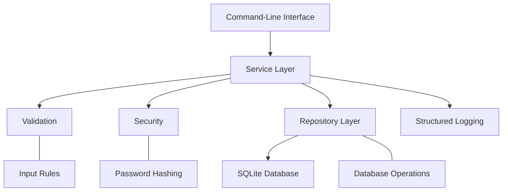
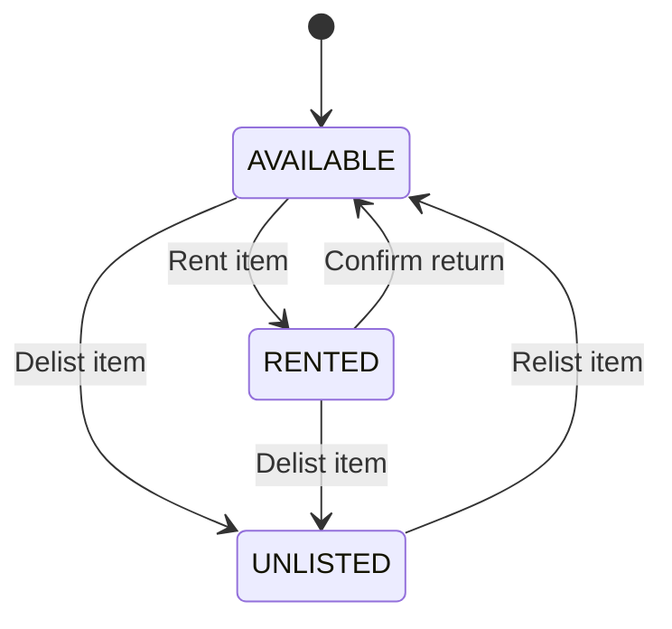

# Multi-User Rental Tracker

A Java-based rental management application built with **Java 17, Maven, and SQLite**. The application supports multiple users, item listings, rental management, and return processing through a command-line interface.

The project emphasizes separation of concerns, input validation, secure password handling, database integrity, structured logging, and automated testing.

## Table of Contents

* [Features](#features)
* [Architecture](#architecture)
* [Technology Stack](#technology-stack)
* [Project Structure](#project-structure)
* [Database Design](#database-design)
* [Security and Validation](#security-and-validation)
* [Prerequisites](#prerequisites)
* [Getting Started](#getting-started)
* [Running the Application](#running-the-application)
* [Running Tests](#running-tests)
* [Docker](#docker)
* [Logging and Error Handling](#logging-and-error-handling)
* [Documentation](#documentation)
* [Team](#team)

## Features

### User Management

* User registration and authentication.
* Password hashing using Argon2id through Password4j.
* Session-aware operations associated with the authenticated user.
* Validation of user input and account details.

### Item Management

* Create and manage item listings.
* View personal inventory.
* Browse available listings.
* Track item availability and listing status.
* Enforce ownership rules for item-related operations.

### Rental Management

* Manage rental records and rental status.
* Prevent invalid rental operations.
* Track active and closed rentals.
* Process returns and update item availability.
* Maintain relationships between users, items, and rentals.

### Data Persistence

* SQLite database for persistent storage.
* JDBC-based database access.
* Relational constraints and foreign-key relationships.
* Repository classes that separate data access from business logic.

### Quality and Maintainability

* Layered application architecture.
* Centralized validation and error handling.
* Structured application logging.
* Automated unit and integration tests.
* Maven-based build and test workflow.
* Docker Compose support for containerized execution.

## Architecture

The application uses a layered architecture to separate command-line interaction, business logic, validation, security, and persistence.



### Main Components

| Layer          | Responsibility                                                     |
| -------------- | ------------------------------------------------------------------ |
| Transport      | Handles application entry point and command-line interaction.      |
| Service        | Implements user, item, and rental business logic.                  |
| Validation     | Checks input and enforces application rules.                       |
| Security       | Handles password hashing and related security functionality.       |
| Repository     | Encapsulates database queries and persistence operations.          |
| Domain         | Represents users, items, rentals, and their states.                |
| Infrastructure | Configures and initializes the database.                           |
| Logging        | Provides structured application events and diagnostic information. |

This separation helps keep business rules independent of command-line input and database implementation details.

## Technology Stack

| Technology     | Purpose                         |
| -------------- | ------------------------------- |
| Java 17        | Application development         |
| Maven          | Build and dependency management |
| SQLite         | Relational data persistence     |
| JDBC           | Database connectivity           |
| Password4j     | Password hashing                |
| Argon2id       | Password hashing algorithm      |
| JUnit 5        | Automated testing               |
| JaCoCo         | Test coverage reporting         |
| Docker         | Containerization                |
| Docker Compose | Container orchestration         |
| Git            | Version control                 |

## Project Structure

The main application source code is organized under `com.kood.rentaltracker`.

```text
src/
└── main/
    └── java/
        └── com/kood/rentaltracker/
            ├── transport/
            │   └── Main.java
            ├── service/
            │   ├── UserService.java
            │   ├── ItemService.java
            │   └── RentalService.java
            ├── repository/
            │   ├── UserRepository.java
            │   ├── ItemRepository.java
            │   ├── RentalRepository.java
            │   └── impl/
            ├── domain/
            │   ├── User.java
            │   ├── Item.java
            │   ├── ItemStatus.java
            │   ├── Rental.java
            │   └── RentalStatus.java
            ├── infrastructure/
            │   ├── Database.java
            │   └── DatabaseInitializer.java
            ├── security/
            │   └── PasswordHasher.java
            ├── validation/
            │   ├── UserValidator.java
            │   ├── ItemValidator.java
            │   └── RentalValidator.java
            └── logging/
                └── AppLogger.java
```

The repository also contains Maven configuration, automated tests, Docker-related files, and project documentation.

## Database Design

The application uses SQLite to persist its core entities.

### Main Tables

| Table          | Purpose                                              |
| -------------- | ---------------------------------------------------- |
| `users`        | Stores user account information.                     |
| `listed_items` | Stores item listings, ownership, and listing status. |
| `rentals`      | Stores rental records and their lifecycle status.    |

Foreign keys connect users, listings, and rentals to preserve relationships between records.

### Item Lifecycle

Items move between availability and listing states according to application rules.



Rental records separately track whether a rental is `ACTIVE` or `CLOSED`.

These states are intended to help prevent conflicting operations, such as renting an unavailable item or processing an invalid return.

## Security and Validation

Security and correctness are considered throughout the application.

* **Password protection:** Passwords are hashed using Argon2id through Password4j rather than stored as plaintext.
* **Input validation:** User, item, and rental inputs are validated before relevant operations are processed.
* **Ownership checks:** Item operations must respect the relationship between the authenticated user and the item.
* **Rental rules:** Business logic validates rental and return operations against current application state.
* **Database integrity:** Relational constraints help protect data consistency.
* **Sensitive logging:** Passwords and password hashes should not be included in application logs.

These measures improve the application's security posture but do not, by themselves, constitute a formal security audit.

## Prerequisites

Install the following tools before running the application locally:

* Java Development Kit (JDK) 17 or later, with Java 17 as the project target.
* Apache Maven.
* Git.

Docker and Docker Compose are required only if you want to use the containerized setup.

SQLite is used as the database engine. Check the project configuration for how its database file is created and initialized.

## Getting Started

### 1. Clone the Repository

```bash
git clone https://github.com/Wikiand/rental-tracker.git
cd rental-tracker
```

### 2. Verify Java and Maven

```bash
java -version
mvn -version
```

Confirm that your environment is compatible with the project's Java version.

### 3. Build the Application

```bash
mvn clean package
```

This cleans the previous build, compiles the source code, runs the configured test lifecycle, and packages the application.

### 4. Run the Application

```bash
mvn exec:java -Dexec.mainClass="com.kood.rentaltracker.transport.Main"
```

If the Maven Exec plugin is not configured in the project, use the launch instructions provided by the repository's Maven configuration.

## Running the Application

The application provides a command-line interface for interacting with the rental management system.

Available operations include:

* Listing an item.
* Viewing personal inventory.
* Browsing available listings.
* Confirming a return.
* Exiting the application.

Authentication and the available operations depend on the application's current session and implementation.

Follow the prompts displayed by the application. Use the repository's documented development or seed-data setup if test accounts are required.

## Running Tests

Run the automated test suite with:

```bash
mvn test
```

To execute the full Maven verification lifecycle, including configured verification and coverage checks, run:

```bash
mvn clean verify
```

The test suite covers application behavior across service, validation, repository, database, logging, and command-line components, as implemented in the project.

### Test Coverage

JaCoCo is used to measure code coverage.

After running the configured verification lifecycle, check whether the HTML report is available at:

```text
target/site/jacoco/index.html
```

Coverage percentages can vary with the codebase and test suite. Consult the report generated from the current revision before publishing specific coverage figures.

## Docker

The project includes Docker-related configuration for running the application in a containerized environment.

If Docker Compose is configured in the repository, build and start the services with:

```bash
docker compose up --build
```

Stop the services with:

```bash
docker compose down
```

Review the Compose configuration for database paths, environment variables, volume mappings, and initialization behavior.

If a named volume is configured for the SQLite database, it can allow database data to persist across container recreation. The exact persistence behavior depends on the current Compose and initialization configuration.

## Logging and Error Handling

The application includes centralized logging and database-related error handling.

The logging component is intended to provide structured diagnostic information, including event context and severity, without exposing sensitive credentials.

Database-related exceptions are handled through dedicated exception types and mapping logic where applicable. This helps distinguish persistence failures, missing records, constraint violations, and mapping errors from ordinary application behavior.

Logs and exception messages should support debugging without revealing passwords, password hashes, or other sensitive information.

## Documentation

Additional technical documentation is maintained in the repository.

* `docs/ER_DIAGRAM.md` — entity-relationship diagram documentation, if present in the current revision.

Refer to the source code and project configuration for implementation details that are not covered in this README.

## Team

This project was developed collaboratively.

| Contributor         | Role        |
| ------------------- | ----------- |
| Christine Nyambura  | Team Leader |
| Zipporah Chibalonza | Team Member |
| Victor Kiama        | Team Member |

## Project Goals

The project demonstrates practical application of:

* Object-oriented programming with Java.
* Layered application and repository design.
* Relational database integration using SQLite and JDBC.
* Authentication and password hashing.
* Input validation and business-rule enforcement.
* Automated testing and coverage measurement.
* Structured logging and exception handling.
* Containerized application workflows.

---

*Built as a collaborative software engineering project, with an emphasis on maintainable architecture, secure development practices, and reliable rental management workflows.*
